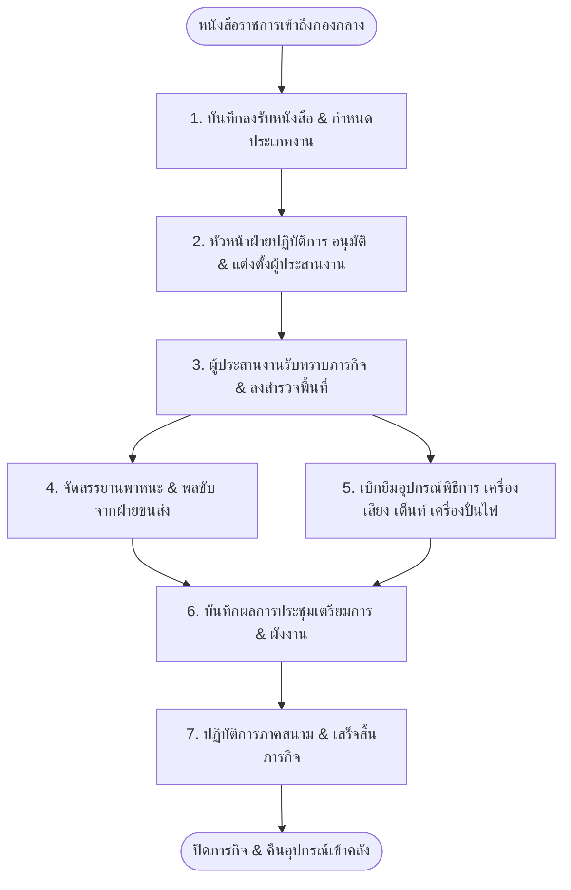

# ผังกระบวนการปฏิบัติงาน (Workflow Architecture)

ระบบบริหารจัดการงานพลับพลาพิธี จำลองขั้นตอนการดำเนินงานจริงของหน่วยงานภาครัฐ จากหนังสือเข้าสู่การลงพื้นที่ ดังนี้:

---

### รายละเอียดขั้นตอนในระบบ Demo

| ขั้นตอน | บทบาทที่รับผิดชอบ | การกระทำในระบบ | ผลลัพธ์ในฐานข้อมูลจำลอง |
|:---|:---|:---|:---|
| **1. ลงรับหนังสือ** | `admin`, `super_admin` | กรอกแบบฟอร์มลงรับหนังสือราชการ, ชื่อโครงการ, หน่วยงานเจ้าภาพ, สถานที่จัดงาน | เอกสารมีสถานะ `pending`, Workflow Step = 1 |
| **2. มอบหมายงาน** | `head_operation`, `super_admin` | เลือกภารกิจที่ยังไม่มีผู้ประสานงาน แล้วกำหนดเจ้าหน้าที่ประสานงาน | เอกสารมีสถานะ `assigned`, Workflow Step = 2 |
| **3. รับทราบงาน** | `coordinator_operation` | กดปุ่ม "ยืนยันรับทราบงานและเริ่มประสานงาน" | เอกสารเปลี่ยนสถานะเป็น `in_progress`, Workflow Step = 3 |
| **4. จัดสรรยานพาหนะ** | `head_vehicle`, `super_admin` | เลือกรถราชการที่ว่าง (รถตู้/รถบรรทุก) และจับคู่พนักงานขับรถ | สร้างบันทึกใน `vehicleAssignments`, Workflow Step = 4 |
| **5. เบิกยืมอุปกรณ์** | `head_operation`, `coordinator_operation` | เลือกอุปกรณ์ (ชุดเครื่องเสียง/เต็นท์/โต๊ะหลุยส์) | หักลด `availableQuantity` ทันที และสร้างประวัติการยืม |
| **6. รายงานการประชุม** | `coordinator_operation` | บันทึกสรุปการประชุมเตรียมการ ผังพลับพลา | สร้างเรคคอร์ดใน `meetingReports` |
| **7. ปิดภารกิจ** | `head_operation`, `super_admin` | ตรวจสอบความเรียบร้อยและกดยืนยันเสร็จสิ้นภารกิจ | สถานะเอกสารเป็น `completed`, Workflow Step = 5 |

