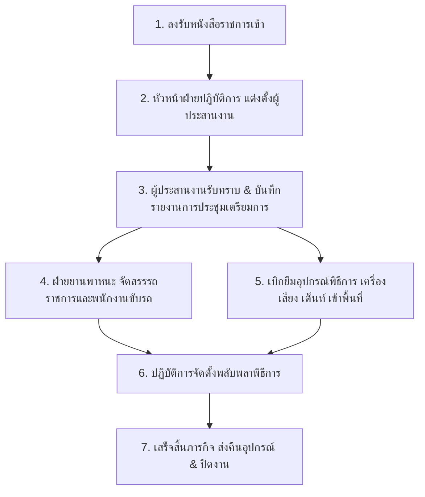

# ระบบบริหารจัดการงานพลับพลาพิธี (Pabpla Ceremony Operations Management System)
## Full Stack TypeScript Portfolio Project (Next.js 16 + React 19 + Express.js REST API)

> **โครงงานการยกระดับสถาปัตยกรรมสู่ TypeScript Enterprise Full Stack (Senior-Level Portfolio Architecture)**  
> ปรับปรุงจากระบบเดิมที่เป็น PHP 8 สู่สถาปัตยกรรม **TypeScript 100% ทั้ง Frontend และ Backend** ออกแบบมาเฉพาะสำหรับการ **นำเสนอผลงานพอร์ตโฟลิโอและการสัมภาษณ์งานระดับ Senior Full Stack / Tech Lead** โดยยังคงดีไซน์ UI/UX สไตล์ราชการดั้งเดิมไว้ครบถ้วนสมบูรณ์ 100% พร้อม In-Memory State Store ที่ไม่จำเป็นต้องต่อ MySQL ภายนอก

---

## 1. ข้อมูลภาพรวมโครงงาน (Project Overview)

ระบบบริหารจัดการงานพลับพลาพิธี เป็นระบบสารสนเทศเชิงปฏิบัติการสำหรับบริหารจัดการหนังสือราชการเข้า ภารกิจจัดตั้งพลับพลาพิธี การมอบหมายผู้ประสานงานภาคสนาม การจัดสรรยานพาหนะและพนักงานขับรถ การเบิกยืม-คืนอุปกรณ์พิธีการ (เครื่องเสียง เต็นท์ เครื่องกำเนิดไฟฟ้า แท่นพระบรมฉายาลักษณ์) และการบันทึกรายงานการประชุมเตรียมการ

### สถาปัตยกรรมเทคโนโลยี (TypeScript Enterprise Tech Stack)

- **Frontend**:
  - **Next.js 16+** (App Router สถาปัตยกรรมล่าสุด พร้อม Turbopack)
  - **React 19** (.tsx Functional Components & Custom Hooks)
  - **TypeScript 5.8+** (Strict Type Safety, Interfaces & Type Declarations)
  - **Bootstrap 5.3 & Bootstrap Icons** (คงอัตลักษณ์ UI/UX ระบบเดิมของหน่วยงานราชการ 100% เป๊ะทุกจุด)
  - **Google Font Prompt** (ฟอนต์สไตล์ราชการไทยมาตรฐาน)
- **Backend (Express.js REST API)**:
  - **Node.js 24+** & **TypeScript 5.8+**
  - **Modular Architecture**: แยกสัดส่วนโฟลเดอร์ตามมาตรฐานอุตสาหกรรม (`controllers/`, `routes/`, `middlewares/`, `store/`, `types/`)
  - **Strict Type Checking**: มี Type Definitions ครบถ้วนทุก Entity (`Document`, `User`, `Vehicle`, `Equipment`, `SystemLog` ฯลฯ)
  - **Role-Based Access Control (RBAC)** Middleware
  - **Automated Testing**: TypeScript Test Suite ผ่าน `node:test` + `node:assert`
- **Mock Data Engine**:
  - **100% Synthetic & Fictional Dataset** (ปลอดภัยสำหรับ Public GitHub ไม่มีข้อมูลลับ/ข้อมูลส่วนบุคคลจริง)
  - **In-Memory Store with Deep-Clone Snapshot** (ประมวลผล State Transitions สมจริง ป้องกัน Data Mutation)
  - **One-Click Demo Reset** (ฟังก์ชันรีเซ็ตข้อมูลจำลองกลับสู่สถานะตั้งต้นใน 5ms)

---

## 2. โครงสร้างโฟลเดอร์ฝั่ง Backend (Clean & Modular Structure)

```text
backend/
├── src/
│   ├── controllers/       # จัดการ Business Logic แยกตามโมดูล (demoController.ts)
│   ├── routes/            # จัดการเส้นทาง REST API (demoRoutes.ts)
│   ├── middlewares/       # จัดการ CORS, Logger, Demo RBAC, Error Handling (auth.ts, errorMiddleware.ts)
│   ├── store/             # In-Memory Store & Deep-Clone Snapshot Engine (dataStore.ts, initialData.ts)
│   ├── types/             # TypeScript Interfaces & Data Models (index.ts)
│   ├── app.ts             # Express Application Factory
│   └── server.ts          # Server Entry Point & Graceful Shutdown
├── tests/                 # Automated API & Business Logic Tests (api.test.ts)
├── tsconfig.json          # TypeScript Compiler Configuration
├── .env.example
└── package.json
```

---

## 2. ผังบทบาทผู้ใช้งาน 8 บทบาท (Role Matrix)

| บทบาท (Role ID) | ชื่อบทบาท (ภาษาไทย) | หน้าที่หลักในระบบ |
|:---|:---|:---|
| `super_admin` | ผู้ดูแลระบบสูงสุด | บริหารจัดการระบบทุกโมดูล, สิทธิ์ผู้ใช้, หนังสือราชการ, รถ, คลังอุปกรณ์, และตรวจสอบ Live Audit Trail |
| `admin` | ผู้ดูแลระบบฝ่ายสารบรรณ | ลงรับหนังสือราชการใหม่, มอบหมายงานไปยังฝ่ายปฏิบัติการ, จัดการสิทธิ์ผู้ใช้ทั่วไป |
| `head_operation` | หัวหน้าฝ่ายปฏิบัติการ | อนุมัติภารกิจ, แต่งตั้งผู้ประสานงานภาคสนาม, อนุมัติยืม-คืนอุปกรณ์, ปิดงานภารกิจ |
| `coordinator_operation`| ผู้ประสานงานภาคสนาม | รับทราบภารกิจ, สำรวจพื้นที่, บันทึกรายงานการประชุมเตรียมการและผังจัดงาน |
| `staff_operation` | เจ้าหน้าที่ฝ่ายปฏิบัติการ | ตรวจสอบงานที่ได้รับมอบหมาย, ยืนยันรับทราบ, ดูตารางเวลาปฏิบัติงาน |
| `head_vehicle` | หัวหน้าฝ่ายยานพาหนะ | จัดสรรรถตู้/รถบรรทุกราชการ, จับคู่พนักงานขับรถตามภารกิจ |
| `staff_vehicle` | เจ้าหน้าที่/พลขับ | ตรวจสอบกำหนดการเดินทาง, ยืนยันการปฏิบัติงานเดินรถ |
| `pending` | ผู้ใช้ใหม่รออนุมัติสิทธิ์ | เข้าสู่ระบบได้แต่ยังไม่มีสิทธิ์ทำงานจนกว่าผู้ดูแลระบบจะกำหนดสิทธิ์ |

---

## 3. ผังกระบวนการปฏิบัติงาน (Workflow Architecture)



---

## 4. ขั้นตอนการติดตั้งและรันระบบบนเครื่อง Local

### ความต้องการขั้นต่ำ (Prerequisites)
- **Node.js**: เวอร์ชัน 18+ (แนะนำ Node.js 20 หรือ 22+)
- **NPM**: เวอร์ชัน 9+
- **ไม่ต้องติดตั้ง MySQL หรือฐานข้อมูลใด ๆ ทั้งสิ้น**

### คำสั่งเริ่มต้น (One-Command Setup)

1. เข้าสู่โฟลเดอร์โปรเจกต์ `typescript`:
   ```bash
   cd typescript
   ```

2. ติดตั้ง Dependencies ทั้ง Frontend และ Backend:
   ```bash
   npm run install:all
   ```

3. รันทั้ง Express API Server และ Next.js Frontend พร้อมกัน:
   ```bash
   npm run dev
   ```

4. เปิดเบราว์เซอร์เข้าใช้งาน:
   - **Frontend App**: [http://localhost:3000](http://localhost:3000)
   - **Backend API**: [http://localhost:4000](http://localhost:4000)

---

## 5. การทดสอบอัตโนมัติ (Automated Testing)

รันชุดทดสอบ Backend API & State Transitions ด้วย Node.js Test Runner:

```bash
cd typescript/backend
npm test
```

คำสั่งนี้คอมไพล์ TypeScript ก่อนรัน Node.js Test Runner ชุดทดสอบ 12 ข้อครอบคลุม health check, ข้อมูลเริ่มต้น, การสร้างเอกสาร, reset, pagination, การค้นหาก่อนแบ่งหน้า, สิทธิ์ของบทบาท, ID หลังลบแล้วสร้างใหม่ และขอบเขตการเก็บ logs

หน้า `/admin2`, `/documents` และ `/view_system_logs` ค้นหาและแบ่งหน้าผ่าน API โดยรอให้หยุดพิมพ์ 250 ms และยกเลิกคำขอเดิมเมื่อเปลี่ยนหน้า/ตัวกรอง

- `GET /api/demo/documents?page=1&limit=25&search=...` คืน `data`, `count` และ `pagination` โดยจำกัด `limit` สูงสุด 100 รายการ คำขอเอกสารที่ไม่ส่ง `page`/`limit` ยังรองรับผู้เรียกเดิมที่ใช้รายการทั้งหมด
- `GET /api/demo/logs?page=1&limit=25&search=...&actions=ASSIGN_COORD,REVOKE_COORD` กรองก่อนแบ่งหน้า ค่าเริ่มต้นคือ 50 รายการ และสูงสุด 100 รายการต่อหน้า
- Demo store เก็บ logs ล่าสุดไม่เกิน 10,000 รายการ โดย ID เพิ่มต่อเนื่องแม้ตัดรายการเก่าออก และเริ่มใหม่เมื่อ reset ข้อมูลเดโม

---

## 6. ฟังก์ชันอำนวยความสะดวกสำหรับ HR & กรรมการสัมภาษณ์

1. **HR Guided Tour**:
   - คลิกที่แถบด้านบนหรือปุ่ม *"HR Guided Demo"* เพื่อเปิดหน้าต่างแนะนำกระบวนการ 7 ขั้นตอนแบบ Interactive
2. **สลับสิทธิ์ได้ทันที (Instant Role Switcher)**:
   - สลับสิทธิ์ผู้ใช้งานผ่าน Dropdown มุมบนขวาได้ทันทีโดยไม่ต้อง Sign Out และจำลองสิทธิ์ระดับ API
3. **One-Click Reset Demo**:
   - ปุ่มสีแดงที่แถบบนสุดช่วยคืนค่าข้อมูลทั้งหมดกลับสู่จุดเริ่มต้นได้ตลอดเวลา

